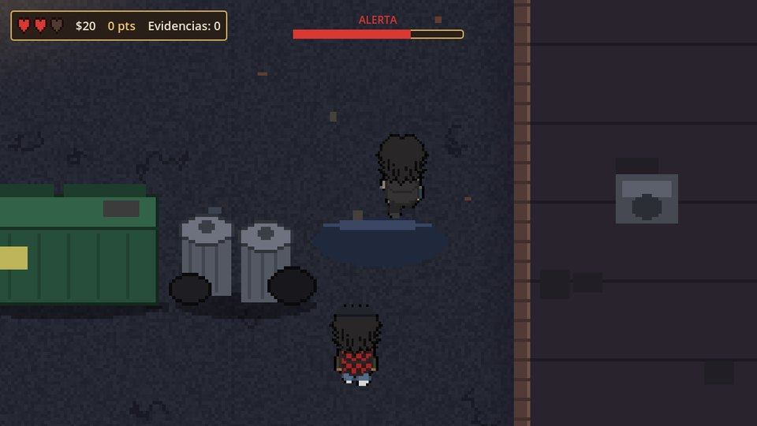

# Espejismo: Falso Cielo

Thriller narrativo top-down 2D ambientado en una versión contemporánea de Hermosillo, Sonora. Mateo Tánori, un joven común sin entrenamiento especial, investiga los expedientes que el gobierno oculta tras el discurso del "Falso Cielo". Para avanzar, recolecta evidencias, corrobora testimonios y evade patrullas sin usar armas. Sus decisiones morales cambian el final.

Proyecto de equipo de la materia **Creación de Videojuegos**, Universidad Tecnológica de Hermosillo (UTH).
Profesor: M.C. Iván Rogelio Chenoweth Chenoweth.

## Ficha

| | |
|---|---|
| **Género** | Thriller narrativo de misterio, sigilo e investigación, top-down 2D (pixel art) |
| **Público objetivo** | Jóvenes y adultos (15+) |
| **Motor** | Godot Engine 4.3 o superior (GDScript) |
| **Plataforma** | Web (exportación HTML5 publicada en GitHub Pages) |
| **Estado** | Beta del prólogo (Actividad 2, `v0.2.0-beta`) |

## Equipo

| Integrante | Rol |
|---|---|
| Demian Leonardo Soto | Narrativa, guion, diálogos y diseño del Nivel 1 |
| José Luis Germán Labandera | Programación base: escenas, jugador, IA de sigilo, guardado de estado y exportación web |
| Filiberto Sañudo | UI/UX (diálogos, HUD, inventario, resultados), score, audio y QA |



## Documentación

- **[Manual de usuario](docs/manual-usuario.md):** controles, objetivo, puntaje, vidas, guardado y problemas comunes.
- **[Reporte de pruebas de la beta](docs/reporte-pruebas-beta.md):** casos de prueba, resultados y bugs encontrados.
- **GDD y documento técnico:** contiene el hardware y software, la historia, los personajes, el mapa del Nivel 1, el score y el plan de trabajo.
- **Tablero del proyecto:** las tareas se organizan como tarjetas en [GitHub Projects](https://github.com/users/Demian-20/projects/1/views/1), a partir de los [issues del repositorio](https://github.com/Demian-20/espejismo-falso-cielo/issues).

## Cómo ejecutar el proyecto

1. Instalar [Godot 4.3 o superior](https://godotengine.org/download) (versión estándar, no la de .NET).
2. Clonar el repositorio:
   ```bash
   git clone https://github.com/Demian-20/espejismo-falso-cielo.git
   ```
3. En Godot, elegir **Importar**, seleccionar el archivo `project.godot` y presionar **F5** para jugar.

## Jugar en el navegador

**[Jugar Espejismo: Falso Cielo](https://demian-20.github.io/espejismo-falso-cielo/)** (Chrome, Edge o Firefox de escritorio; también abre en celular, pero se juega con teclado).

La versión web se exporta y publica sola con GitHub Actions (`.github/workflows/web.yml`):

- En cada PR hacia `dev` o `main` se exporta el juego para comprobar que la build no se rompe. La build queda como artefacto descargable en la pestaña **Actions**.
- En cada push a `main` (las entregas) se exporta y se publica en la rama `gh-pages`.
- La exportación usa la plantilla web **sin hilos** (`thread_support=false`), porque GitHub Pages no manda los encabezados que necesita la versión con hilos y el juego se quedaría en pantalla negra.

Para exportar a mano desde Godot: **Proyecto > Exportar > Web > Exportar proyecto**, con destino `build/web/index.html` (la carpeta `build/` no se sube al repositorio).

## Flujo de trabajo

- **Ramas:**
  - `main` guarda solo versiones estables y entregables.
  - `dev` es la rama de integración.
  - Cada tarea se trabaja en su propia rama, creada desde `dev` con el formato `tipo/número-descripción` (ej. `feat/006-ia-sigilo`).
- **Commits:** siguen el formato [Conventional Commits](https://www.conventionalcommits.org/es/) y mencionan el issue, por ejemplo: `feat(ui): caja de diálogo con opciones (#3)`.
- **Pull Requests:**
  - Cada rama se integra a `dev` con un PR que incluye una descripción, una captura o GIF y la línea `Closes #n`.
  - Filiberto revisa los PR y deja un comentario si algo no cuadra con el GDD o el plan.
- **Escenas de Godot:** cada integrante trabaja en sus propias escenas (`.tscn`) y scripts para evitar conflictos.
- **Entregas:** al cierre de cada entrega, `dev` se fusiona en `main`, se marca una versión (`v0.1`, `v0.2`, …) y se publica en GitHub Pages.

## Créditos de recursos

- **Sprites de personajes (64×64):** derivados del sprite base "Evelyn" que está en `assets/evelyn/`. Fuente y licencia del sprite base por confirmar.
- **Diseños de personajes y retratos:** diseños de referencia de Demian Leonardo Soto, creados con herramientas de IA. Los retratos de `assets/retratos/` se recortaron de esos diseños y se pasaron a pixel art.
