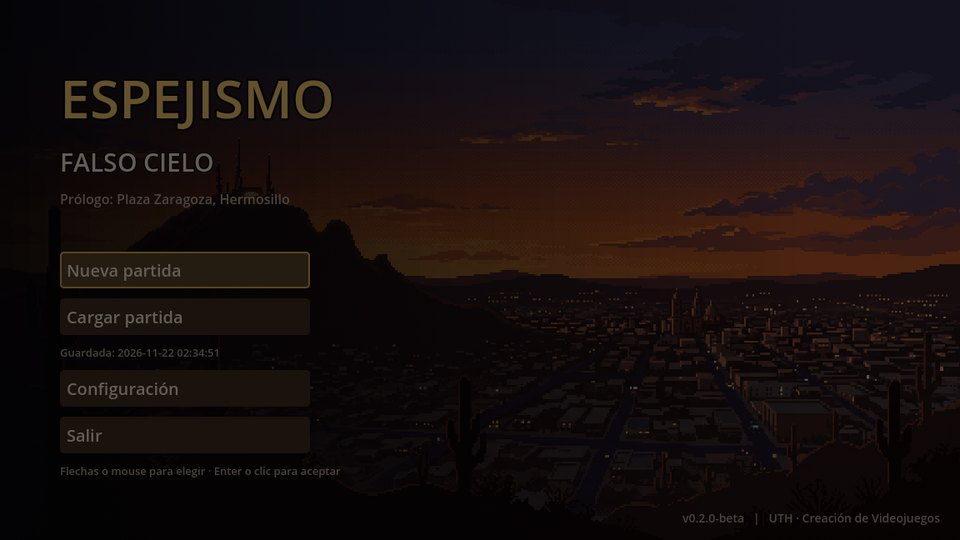
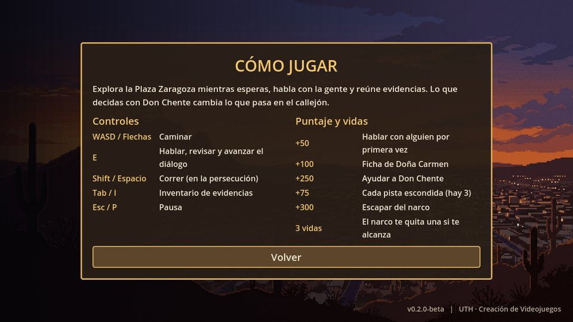
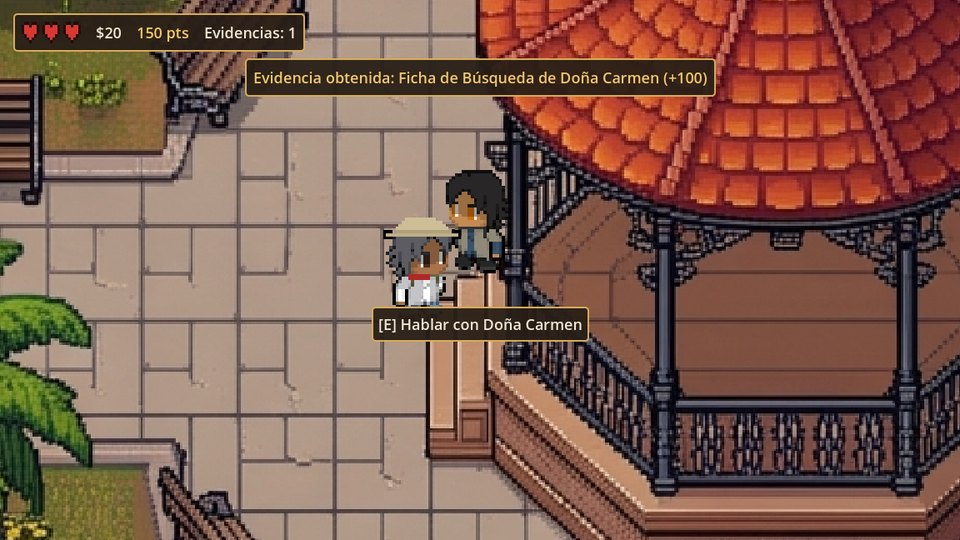
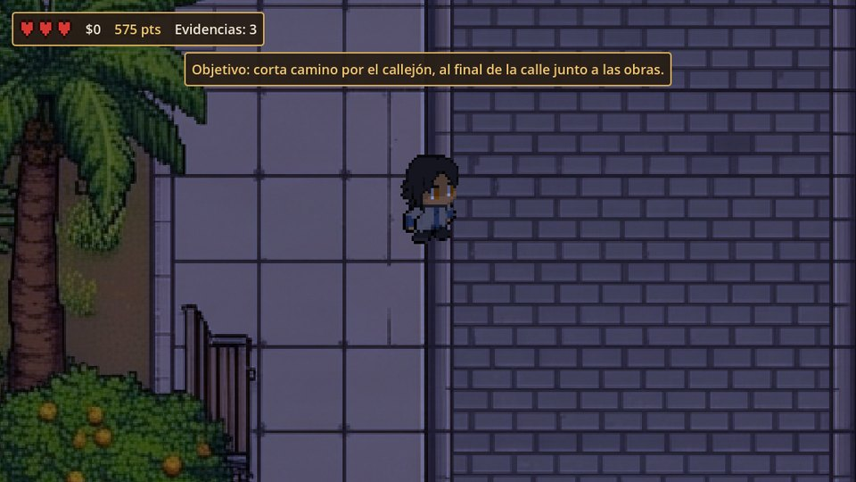
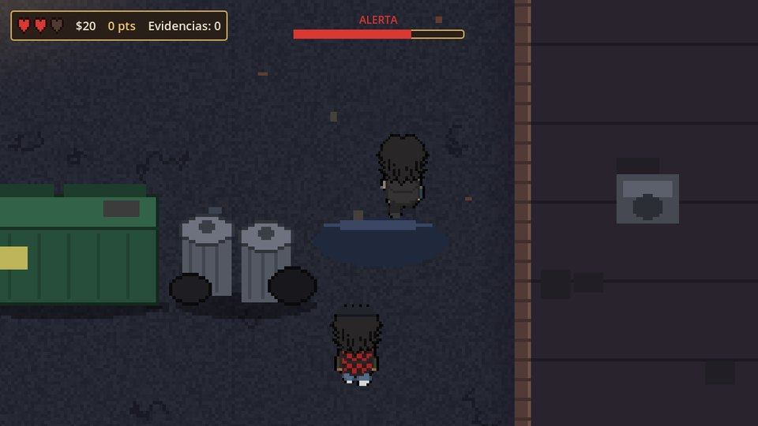
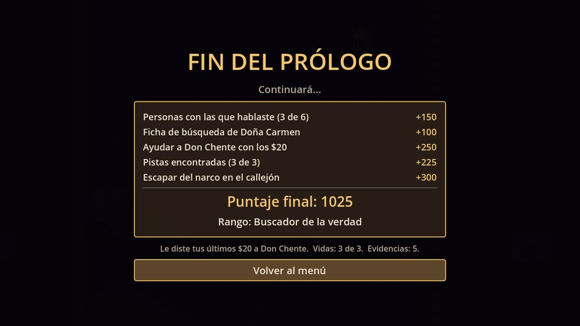
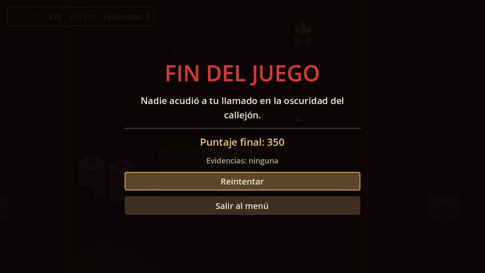
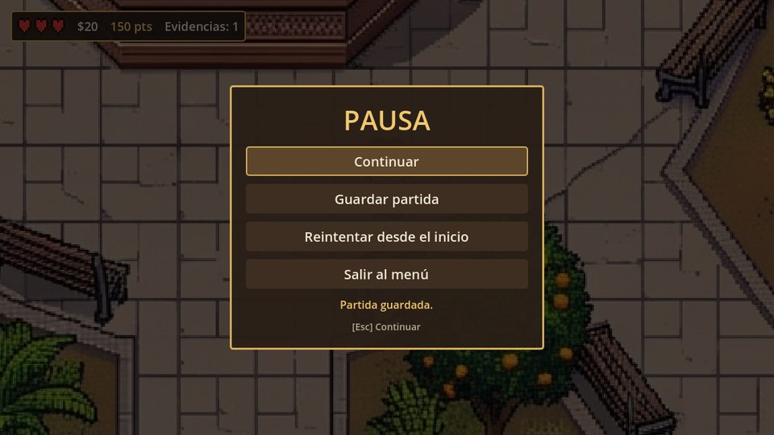

# Manual de usuario: Espejismo: Falso Cielo (Prólogo, beta v0.2.0)

Espejismo: Falso Cielo es un thriller narrativo top-down 2D en pixel art, ambientado en Hermosillo, Sonora. Esta beta contiene el **prólogo completo**: una tarde en la Plaza Zaragoza que termina en un callejón, con dos finales según lo que decidas.

## 1. Cómo abrir el juego

**En el navegador (recomendado)**

1. Entra a https://demian-20.github.io/espejismo-falso-cielo/ desde Chrome, Edge o Firefox de computadora.
2. Espera a que cargue (unos 60 MB la primera vez).
3. Da un clic dentro del juego antes de usar el teclado, para que el navegador le pase las teclas y active el sonido.

**Desde Godot**

1. Instala Godot 4.3 o superior (versión estándar, no la de .NET).
2. Clona el repositorio: `git clone https://github.com/Demian-20/espejismo-falso-cielo.git`
3. En Godot elige **Importar**, selecciona `project.godot` y presiona **F5**.

## 2. Menú principal

| Opción | Qué hace |
|---|---|
| **Nueva partida** | Empieza el prólogo desde las pantallas de apertura. |
| **Cargar partida** | Continúa la última partida guardada. Debajo aparece la fecha; si no hay ninguna, está desactivada. |
| **Cómo jugar** | Muestra los controles, el objetivo, el puntaje y las vidas. |
| **Configuración** | Volumen de la música, volumen de los efectos y pantalla completa. Se guarda para la próxima vez. |
| **Salir** | Cierra el juego. En la versión web no aparece. |

En el menú se elige con las flechas o el mouse y se acepta con Enter o clic.

## 3. Controles

| Tecla | Acción |
|---|---|
| **W A S D** o **flechas** | Caminar (sin diagonales). |
| **E** | Hablar con alguien o revisar un objeto. |
| **E**, **Espacio** o **clic** | Avanzar los diálogos y las pantallas de apertura. |
| **W / S** o **flechas arriba / abajo** | Elegir una respuesta cuando un diálogo tiene opciones. |
| **Shift** o **Espacio** | Correr. Solo funciona durante la persecución del callejón. |
| **Tab** o **I** | Abrir y cerrar el inventario de evidencias. |
| **Esc** o **P** | Pausa. |

Cuando estás cerca de alguien o de algo que se puede usar, aparece un aviso como **[E] Hablar con Doña Carmen** o **[E] Revisar**.

## 4. La pantalla

- **Marcador (arriba a la izquierda):** vidas (corazones), dinero, puntaje y número de evidencias. Se oculta mientras hay un diálogo.
- **Notificaciones (arriba al centro):** avisan cuando consigues una evidencia o una pista, y el objetivo cuando cambia.
- **Barra de ALERTA:** aparece en la persecución y se llena mientras más cerca está el perseguidor.
- **Caja de diálogo:** muestra el retrato y el nombre de quien habla. Cada personaje tiene su propio tono de voz.

## 5. Objetivo y cómo avanzar

1. **Apertura:** Mateo espera en una banca de la Plaza Zaragoza a alguien que no llega. Recibe dos llamadas.
2. **Explorar la plaza (de tarde):** camina libremente, habla con la gente y busca pistas. Todo esto es opcional y da puntos. Doña Carmen, junto al quiosco, te da una evidencia importante.
3. **Cruzar hacia la Catedral:** al pasar a la calle, Don Chente te detiene y te pide **$20**. Lo que decidas cambia el final.
4. **Anochece:** la plaza se vacía. Ve al final de la calle, junto a las obras, y corta camino por el callejón.

5. **El callejón:** alguien te descubre y te persigue. Mantén **Shift** para correr y esquiva las cajas, los botes y los escombros hasta el fondo.

6. **El final:** depende de tu decisión con Don Chente. En uno de los finales se termina el prólogo y aparece la pantalla de resultados.

## 6. Puntaje

| Acción | Puntos |
|---|---|
| Hablar con una persona por primera vez (hay 6) | +50 |
| Recibir la ficha de búsqueda de Doña Carmen | +100 |
| Ayudar a Don Chente con los $20 | +250 |
| Encontrar una pista escondida (hay 3; brillan un poco) | +75 |
| Escapar del perseguidor en el callejón | +300 |

El puntaje máximo del prólogo es **1175**. Al final aparece el desglose y un rango: *Testigo*, *Investigador* o *Buscador de la verdad*.

## 7. Vidas y Game Over

- Empiezas con **3 vidas**.
- Si te alcanzan en el callejón pierdes una vida y la persecución vuelve a empezar.
- Con 0 vidas aparece el **Game Over**:
  - **Reintentar** te regresa al último punto de control, justo antes de hablar con Don Chente, con 3 vidas.
  - **Salir al menú** te lleva al menú principal.

## 8. Pausa y guardado

Con **Esc** o **P** se abre la pausa:

- **Continuar**: regresa al juego.
- **Guardar partida**: solo funciona de tarde, mientras exploras la plaza. De noche el menú avisa que no se puede.
- **Reintentar**: vuelve al último punto de control.
- **Cómo jugar**: muestra la ayuda.
- **Salir al menú**: regresa al menú principal.

La partida guardada y la configuración se quedan en la computadora. En la web se guardan en el navegador, así que no pasan a otro equipo.

## 9. Problemas comunes

| Problema | Solución |
|---|---|
| Las teclas no responden en la web | Da un clic dentro del juego. |
| No se oye nada en la web | El navegador activa el sonido después del primer clic o tecla. Revisa también el volumen en Configuración. |
| La pantalla se queda negra en la web | Usa Chrome, Edge o Firefox de computadora y recarga la página. |
| No puedo entrar al callejón | Primero hay que hablar con Don Chente; el callejón solo se abre de noche. |
| No me deja guardar | Solo se puede guardar de tarde, antes de hablar con Don Chente. |
