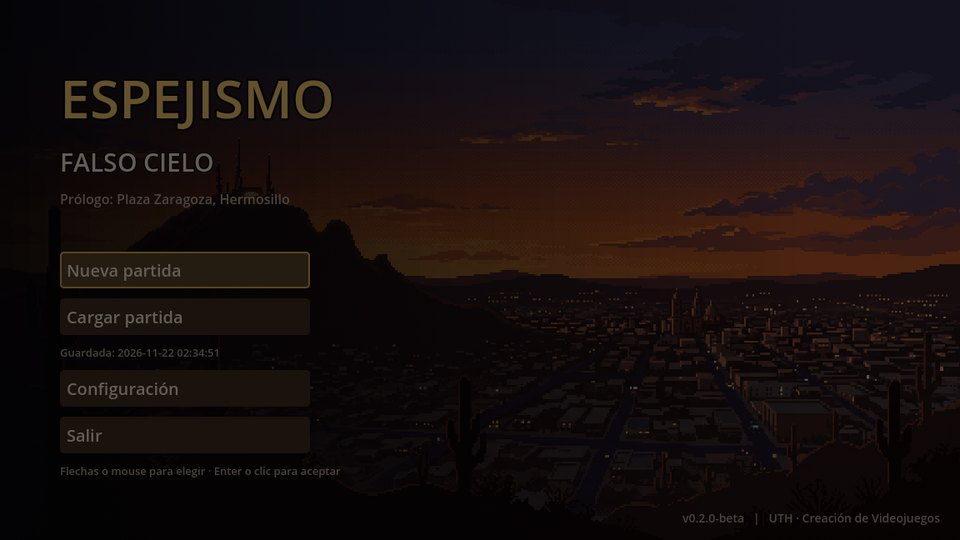
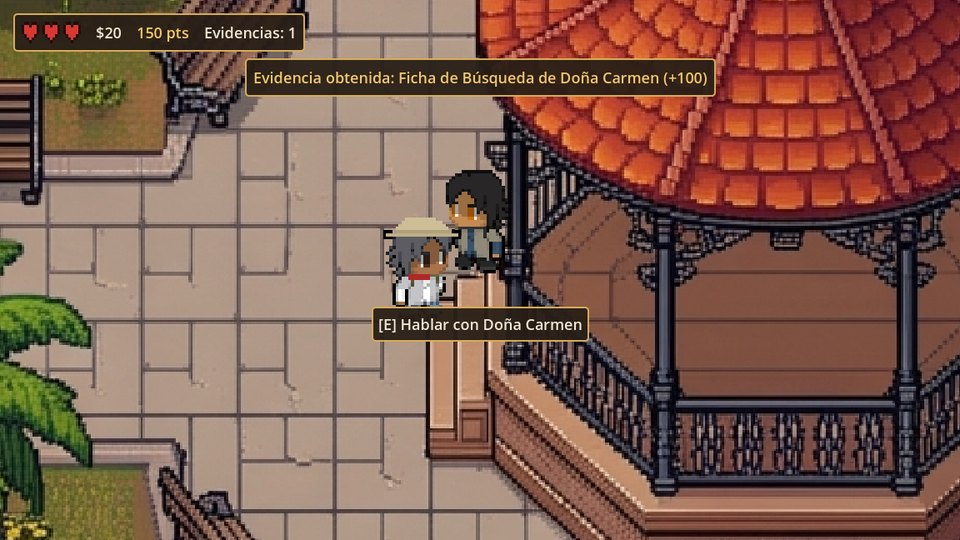
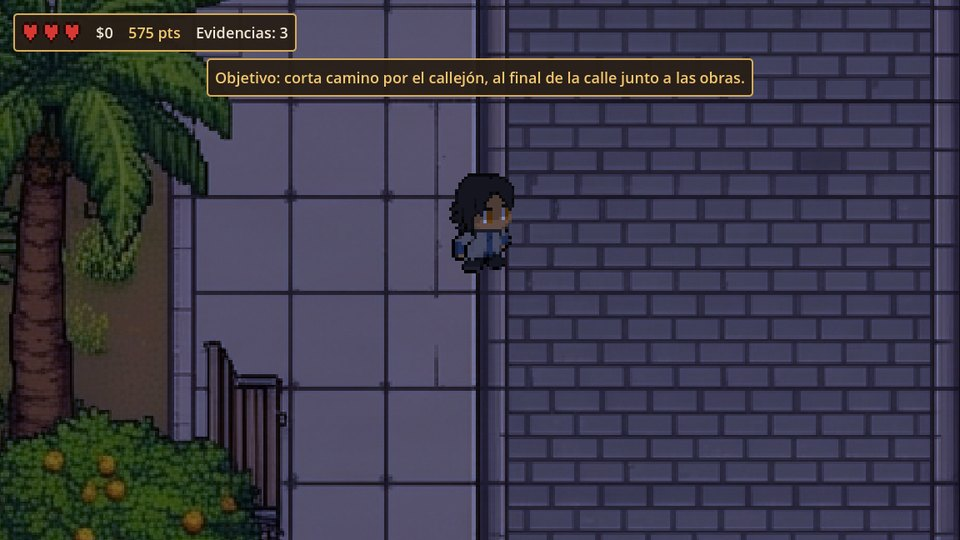
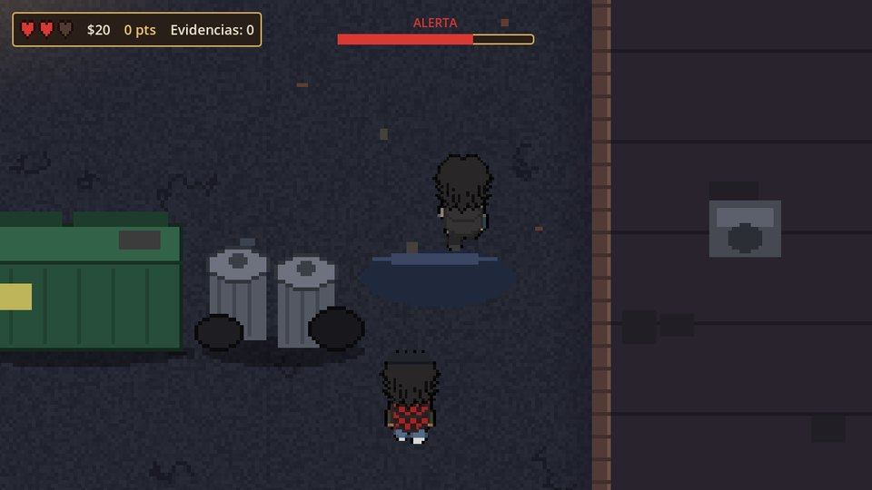
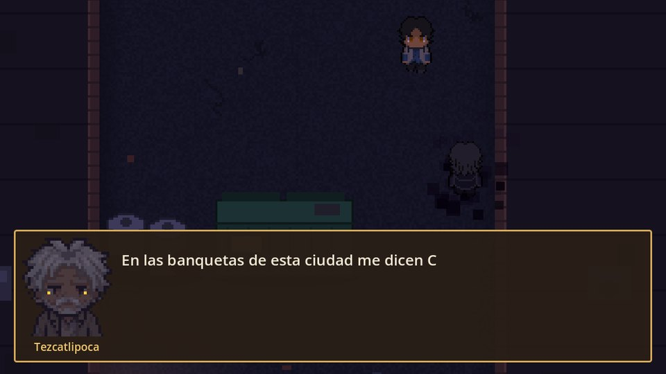
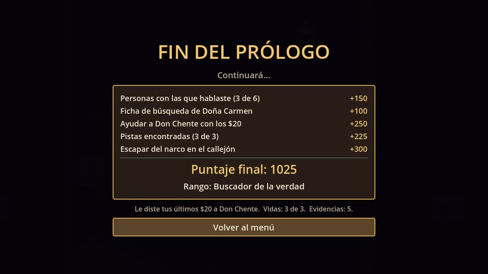

# Reporte de pruebas de la beta (v0.2.0-beta)

**Proyecto:** Espejismo: Falso Cielo, prólogo
**Responsable de QA:** Filiberto Sañudo (issue #13)
**Fecha:** 22 de noviembre de 2026

## 1. Alcance

Se probó el prólogo completo, del menú principal a los dos finales. Se revisaron los siete elementos que pide la Actividad 2 (eventos, comportamientos, transacciones, acciones, colisiones, puntaje y vidas), además del menú, el guardado y la versión web.

Versión probada: la rama del PR #31 (prólogo completo). Ya incluye todo lo que está en `dev` (los PRs #32, #33 y #34 de Germán y el menú #29) y la rama del #16. La corrección del clic de la intro (PR #36) se probó en la build web de su propio PR.

## 2. Ambiente

| | |
|---|---|
| Sistema | Windows 11 Pro |
| Motor | Godot 4.3 stable, renderizador Compatibility (OpenGL) |
| Resolución | 1152 × 648 |
| Web | Build exportada por GitHub Actions (`barichello/godot-ci:4.3`, plantilla sin hilos), probada en Chrome |

## 3. Cómo se probó

1. **Pruebas automáticas dentro de Godot.** Por cada issue se escribió un autoload de prueba temporal (no se sube al repositorio) que corre el juego real:
   - simula las teclas (E, Shift, flechas, Esc);
   - mueve a Mateo con un piloto automático;
   - revisa el estado de `GameState`, del HUD y de los nodos con comprobaciones de tipo "OK / FALLA".
   - En modo gráfico guarda capturas de pantalla.
2. **Prueba de integración.** Se juntaron todas las ramas en una rama local y se volvieron a correr todas las pruebas, para asegurar que no se rompían entre sí.
3. **Prueba manual en el navegador.** Se descargó la build web que genera GitHub Actions y se jugó en Chrome.

| Prueba automática | Issue / PR | Comprobaciones | Resultado |
|---|---|---|---|
| Acciones: interactuar y correr | #8 / #32 | 29 | 29 de 29 |
| Narco y callejón | #7 / #33 | 23 | 23 de 23 |
| NPCs ambientales | #16 | 31 | 31 de 31 |
| Menú, guardar y cargar | #28 / #29 | 32 | 32 de 32 |
| Prólogo completo, dos finales | #30 / #31 | 34 | 34 de 34 |
| **Total** | | **149** | **149 de 149** |

Las partes anteriores (GameState #11, caja de diálogo e inventario #3, Game Over y pausa #12, audio #4) se probaron en sus propios PRs y vuelven a pasar por la prueba del prólogo completo.

## 4. Casos de prueba

| ID | Elemento | Caso | Resultado esperado | Resultado |
|---|---|---|---|---|
| TC-01 | Eventos | Nueva partida | Pantallas "Hermosillo, Sonora" y "Plaza Zaragoza — 5:45 PM", monólogo en la banca y cambio a la plaza. | Aprobado. Con el clic fallaba en la web (#35), ya corregido. |
| TC-02 | Eventos | Llamadas de Valeria y Antonio | Suenan una sola vez; no se repiten al reintentar ni al cargar una partida. | Aprobado |
| TC-03 | Eventos | Doña Carmen | Al terminar su diálogo entrega la "Ficha de Búsqueda de Doña Carmen", suma +100 y muestra una notificación. | Aprobado |
| TC-04 | Eventos | Cruzar hacia la Catedral | Se detiene a Mateo, empieza el encuentro con Don Chente y se guarda el punto de control. | Aprobado |
| TC-05 | Eventos | Anochecer | Tween sobre el `CanvasModulate`, etapa NOCHE, ambiente `plaza_noche`, se van los civiles y aparece el objetivo. | Aprobado |
| TC-06 | Eventos | Entrada al callejón | De tarde no aparece; de noche muestra "[E] Cortar camino por el callejón" y lleva al callejón con un fundido. | Aprobado |
| TC-07 | Comportamientos | Persecución del narco | Persigue esquivando obstáculos con `NavigationAgent2D`. Caminando alcanza a Mateo; corriendo no. | Aprobado (el margen mínimo corriendo fue de 42 px) |
| TC-08 | Comportamientos | Civiles | Recorren su ruta sin atorarse y se detienen mientras platican; Cárdenas se queda fijo. | Aprobado |
| TC-09 | Comportamientos | Acorralamiento | Al llegar a la reja, el narco se acerca, saca la pistola y emite `mateo_acorralado`. | Aprobado |
| TC-10 | Transacciones | Darle los $20 a Don Chente | Dinero $0, `ayudo_a_chente = true`, +250 y la evidencia "Obsidiana humeante". | Aprobado |
| TC-11 | Transacciones | No darle los $20 | Conserva $20; de noche Don Chente ya no vuelve a preguntar. | Aprobado tras corregir #39 |
| TC-12 | Acciones | Interactuar con E | Aviso "[E] …" de lo más cercano; Mateo voltea y se abre el diálogo. No funciona en diálogo ni en pausa. | Aprobado |
| TC-13 | Acciones | Correr | Solo en la persecución: velocidad 210 y animación a 1.8; al soltar Shift vuelve a 160. | Aprobado |
| TC-14 | Acciones | Inventario | Tab o I muestra las evidencias con su descripción. | Aprobado |
| TC-15 | Acciones | Pausa | Continuar, Guardar partida, Reintentar, Cómo jugar y Salir al menú. Esc cierra la ayuda antes que la pausa. | Aprobado |
| TC-16 | Colisiones | Plaza | Mateo no atraviesa bancas, jardineras, quiosco ni edificios. Las rutas de los NPCs no se atoran. | Aprobado |
| TC-17 | Colisiones | Callejón | Muros, reja y 8 obstáculos en 4 filas que obligan a zigzaguear; la cámara no sale del callejón. | Aprobado |
| TC-18 | Puntaje | Hablar con la gente | +50 solo la primera vez con cada una de las 6 personas. | Aprobado |
| TC-19 | Puntaje | Pistas escondidas | +75 cada una; la pista desaparece y queda en el inventario. | Aprobado |
| TC-20 | Puntaje | Escapar del narco | +300 al llegar a la reja. | Aprobado |
| TC-21 | Puntaje | Pantalla de resultados | El desglose suma exactamente el puntaje final; el rango corresponde. | Aprobado (1025 de 1175, "Buscador de la verdad") |
| TC-22 | Vidas | Te alcanzan en el callejón | -1 vida, la persecución vuelve a empezar y avisa cuántas vidas quedan. | Aprobado |
| TC-23 | Vidas | 0 vidas en la persecución | Game Over con "El narco te alcanzó en el callejón." | Aprobado |
| TC-24 | Vidas | Final sin los $20 | Disparo, animación de muerte y Game Over con el mensaje del guion. Reintentar regresa antes de Don Chente con 3 vidas. | Aprobado |
| TC-25 | Eventos | Final con los $20 | Las luces parpadean, sale humo, aparece Tezcatlipoca, el narco desaparece y sigue el diálogo hasta "Fin del prólogo". | Aprobado |
| TC-26 | Menú | Menú principal | Sin marcador ni pausa; Cargar está desactivado si no hay partida. | Aprobado |
| TC-27 | Menú | Guardar y cargar | Guardar solo de tarde; al cargar se restauran el puntaje, las evidencias y la posición. | Aprobado |
| TC-28 | Menú | Configuración | El volumen se aplica al momento y se recuerda al volver a abrir. | Aprobado |
| TC-29 | Web | Build en el navegador | Carga sin pantalla negra ni errores en consola; "Salir" no aparece. | Aprobado |
| TC-30 | Web | Clic en la intro | El clic avanza las pantallas de apertura. | Falló, se registró como #35 y se corrigió en el PR #36 (verificado en Chrome). |

## 5. Bugs encontrados

| Issue | Bug | Estado |
|---|---|---|
| #35 | El clic no avanzaba las pantallas de apertura: el fondo de la intro se quedaba con el clic. | Corregido en el PR #36 |
| #37 | Los retratos de Don Chente no cargaban: estaban en `scripts/` y el código los buscaba en `assets/retratos/`. | Corregido en el PR #29 |
| #38 | Con F5 no se veía la intro: la escena principal seguía siendo la plaza. | Corregido en el PR #29 |
| #39 | Don Chente volvía a pedir los $20 de noche y se podía cambiar el final. | Corregido en el PR #31 |

También se corrigieron, antes de fusionar, problemas que salieron en las pruebas de cada rama:

- **Persecución:** los obstáculos se podían esquivar subiendo en línea recta, y al reiniciar el primer paso libre quedaba del lado del narco. Se acomodaron en filas alternadas.
- **Final con Tezcatlipoca:** Tezcatlipoca y el narco quedaban tapados por la caja de diálogo. Ahora la cámara se aleja y baja en el desenlace.
- **Exportación web:** fallaba porque la imagen de Docker no define `GODOT_VERSION`.
- **Game Over:** dejaba un diálogo a medias (#12).
- **Diálogos con opciones:** las opciones tapaban la pregunta (#3).
- **Intro:** tenía llamadas duplicadas que chocaban con las de la plaza (corregido por Demian en el PR #26).

## 6. Pendientes conocidos

- El tema musical del epílogo queda para la Act 3 (#4).
- La música y los efectos están sintetizados; se pueden reemplazar más adelante.
- El enlace de GitHub Pages queda activo cuando el dueño del repositorio elige la rama `gh-pages` en Settings > Pages.

## 7. Capturas

| | |
|---|---|
|  |  |
|  |  |
|  |  |
